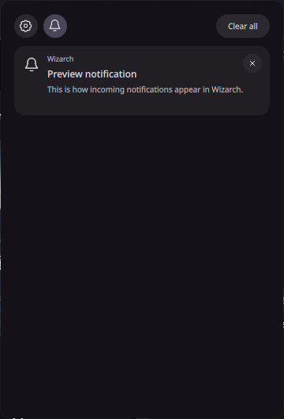
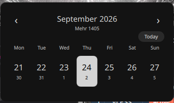
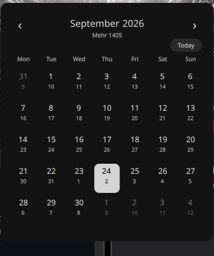
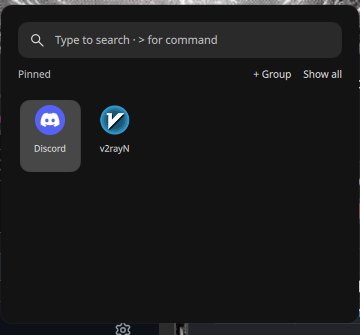
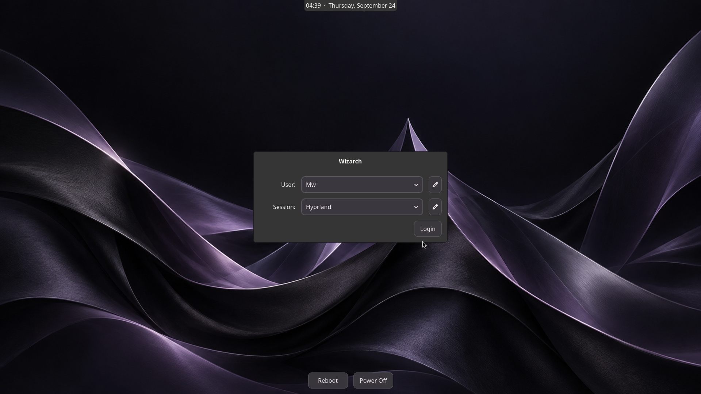

# Wizarch

A compact Quickshell desktop shell for Arch Linux and Hyprland (Lua configuration). A top-center pill opens the app launcher, calendar, quick settings, theme picker, input picker, and notification center, paired with per-monitor workspaces, window controls, a quick-action wheel, and a multi-page Settings window.

<p align="center"></p>

## Screenshots

| Quick settings | Notifications |
| --- | --- |
|  |  |

| Calendar · week | Calendar · month |
| --- | --- |
|  |  |

<p align="center"></p>

| Launcher | Settings |
| --- | --- |
|  |  |

<p align="center"></p>

## What it does

- **Top-center Pill (`Pill.qml`)**: Displays the theme emblem, workspace indicator (9 slots per monitor), clock, and live hardware indicators on each screen. Supports connected or floating placement, auto-hide (push or overlay reveal), optional hide-on-empty-monitor, and an optional screen border that can follow Hyprland's window corner radius.
- **Launcher (`LauncherView.qml`)**: Shows pinned apps, drag-and-drop reordering, compact (4-icon preview) and large (8 direct launch tiles + open-group tile) app groups, search across all desktop entries, and interactive `>command` shell execution (requiring an explicit confirmation prompt before running).
- **Calendar (`CalendarView.qml`)**: Rolling week, month, and year views across `1901–2099` with selectable Gregorian or Solar Hijri primary/secondary calendars, weekday style (`Follow calendar`, `Iranian · Sat–Fri`, `Mon–Sun`, `Sun–Sat`), and up to 500 device-local calendar events.
- **Quick Settings (`QuickSettings.qml`) & Media (`MediaCard.qml`)**: Power actions (`Shutdown`, `Sign Out`, `Restart`, `Sleep`, `Hibernate`), Wi-Fi & Bluetooth detail panels, quick toggle grid (`Sound`, `Microphone`, `Screenshot`, `Desktop`, `Airplane mode`, `Do not disturb`, `Screen record`, `Battery saver`), volume/brightness sliders, capability-gated MPRIS media card, system tray icons, and minimized window restore icons. Controls for absent hardware or uninstalled optional tools show an explicit unavailable/disabled state rather than placeholder values.
- **Notification Center (`NotificationCenter.qml`)**: Acts as the desktop `org.freedesktop.Notifications` daemon, displaying notification summary/body, urgent highlighting, per-card dismiss, and Clear all.
- **Input Picker (`InputPicker.qml`)**: Clipboard history via `cliphist`/`wl-copy` (with paste-back into the previously focused window) and an emoji picker.
- **Quick-Action Wheel (`QuickWheel.qml`)**: Circular `Super+W` overlay on the focused monitor with 8 actions (`Launcher`, `Calendar`, `Quick settings`, `Notifications`, `Clipboard`, `Screenshot`, `Themes`, `Settings`) operable by pointer or keyboard (`Arrows`, `Tab`/`Shift+Tab`, `Home`/`End`, `Enter`/`Space`).
- **Settings Window (`SettingsWindow.qml`)**: Tiled application window with searchable sidebar (`Ctrl+F`) across 12 categories (`Wi-Fi`, `Network`, `Bluetooth`, `Displays`, `Sound`, `Power`, `Multitasking`, `Appearance`, `Panel`, `Notifications`, `Calendar`, `Keyboard`), per-display UI scaling (`100%–200%`), live window spacing (`0–150%`), local Material theme preview/apply/rollback, and local collection import.
- **Per-monitor Workspaces & Scrolling (`workspaces.py`, `layouts.py`, `wizarch-windows.lua`)**: Nine independent workspaces per monitor, empty-desktop toggle, per-workspace Dwindle/Scrolling layout persistence (`Super+Ctrl+L`), and 96% column width with live adjacent-window side peeks in Scrolling mode.

## Requirements

Targets **Arch Linux** running **Hyprland with Lua configuration** (developed against Hyprland 0.56.x and Quickshell 0.3.x).

Core packages:

```sh
sudo pacman -S --needed git hyprland quickshell python util-linux kitty pipewire wireplumber upower wl-clipboard cliphist
```

Optional runtime packages (corresponding UI controls remain disabled or unavailable if omitted):

- **Screenshots & screen lock**: `grim`, `slurp`, `satty`, `hyprlock`
- **Wi-Fi / hotspot / radios / power profiles / screen recording**: `networkmanager` (`nmcli`), `rfkill`, `power-profiles-daemon` (`powerprofilesctl`), `wf-recorder`
- **Bluetooth**: BlueZ (`bluetooth.service`) and a Bluetooth adapter
- **Desktop dark/light synchronization & laptop backlight**: `glib2` (`gsettings`), `gsettings-desktop-schemas`, `xdg-desktop-portal-gtk`, Qt's GTK3 platform plugin, and `/sys/class/backlight` + `systemd-logind`
- **Full Material theme validation & key-based generation**: Create `$XDG_DATA_HOME/wizarch/theme-runtime` with `quickshell/requirements-theme.lock` (`Pillow`, `jsonschema`, `material-color-utilities`). Without this venv, Wizarch still starts using its built-in fallback palette (`Fallback.js`). See [docs/material-theme/AUTHORING.md](docs/material-theme/AUTHORING.md).

Because Wizarch registers `org.freedesktop.Notifications`, stop or mask other notification daemons (`mako`, `dunst`, `swaync`, etc.) before running it.

## Safe installation

Clone the repository and run the interactive installer from inside your user account (never run `install.sh` with `sudo`):

```sh
git clone https://github.com/ManiWizard/Wizarch.git
cd Wizarch
```

Preview every check, backup path, and file copy first:

```sh
bash scripts/install.sh --dry-run
```

Run the interactive install:

```sh
bash scripts/install.sh
```

What `scripts/install.sh` does:

1. Checks core and optional runtime dependencies read-only and prints the exact `pacman` command if anything is missing (never runs `sudo`).
2. Asks before each major step:
   - Backing up any existing `$XDG_CONFIG_HOME/quickshell` and copying `quickshell/` into place.
   - Backing up and installing `wizarch-open`, `hypr-desktop`, and `hypr-screenshot` into `~/.local/bin/`.
   - Backing up and installing `wizarch-bindings.lua`, `wizarch-windows.lua`, and `hyprlock.conf` into `$XDG_CONFIG_HOME/hypr/`, and optionally appending a fenced loader block (`-- >>> wizarch-managed-start >>>`) to `$XDG_CONFIG_HOME/hypr/hyprland.lua`.
   - Running offline theme initialization (`themes.py init wizarch`).
   - Optionally reloading `hyprctl` and starting `qs --no-duplicate --daemonize` if a live Hyprland session is active.
3. Saves timestamped backups and a manifest under `$XDG_STATE_HOME/wizarch/install-backups/` so removal can cleanly restore your prior files.

## Safe uninstallation

Preview what will be removed and restored:

```sh
bash scripts/uninstall.sh --dry-run
```

Run the interactive uninstaller:

```sh
bash scripts/uninstall.sh
```

`scripts/uninstall.sh` reads the manifest created by `scripts/install.sh`, asks before each phase, removes only files and `hyprland.lua` loader lines added by the installer (preserving any later edits you made outside the Wizarch block), and restores your backed-up `~/.config/quickshell`, `~/.local/bin/*`, and Hyprland files.

## Keybindings

Bindings are defined in `examples/hyprland-wizarch.lua` and `examples/wizarch-windows.lua`:

| Shortcut or click | Action |
| --- | --- |
| Click hat / `Super+Space` | Toggle Launcher |
| Right-click hat / `Super+Alt+T` | Toggle Themes / Appearance in Settings |
| Click clock / `Super+Alt+C` | Toggle Calendar |
| Click status / `Super+Alt+Q` | Toggle Quick Settings |
| Click bell / `Super+Alt+N` | Toggle Notification Center |
| `Super+V` / `Super+.` | Clipboard history / Emoji picker |
| `Super+W` | Open Quick-Action Wheel (`Arrows`, `Tab`/`Shift+Tab`, `Home`/`End`, `Enter`/`Space`, `Esc`/right-click) |
| `Super+Shift+S` | Area screenshot with `slurp` + `grim` + `satty` |
| `Super+L` | Lock screen with `hyprlock` |
| `Super+1…9` / `Super+Mouse Wheel` | Switch workspace 1–9 on focused monitor |
| `Super+Shift+1…9` | Move focused window to workspace 1–9 on its monitor |
| `Super+D` | Toggle empty desktop on focused monitor |
| `Super+Arrows` | Focus neighbor window (column focus in Scrolling mode) |
| `Super+Shift+Arrows` / `Super+Ctrl+Shift+Arrows` | Move focused window to monitor in direction and follow |
| `Super+Ctrl+Alt+Left/Right` | Swap window / column left or right |
| `Super+Ctrl+L` | Toggle Dwindle / Scrolling layout on current workspace |
| `Super+J` | Toggle Dwindle split orientation |
| `Super+T` / `Super+Shift+V` | Toggle floating / tiling |
| `Super+F` / `Super+Alt+F` | Toggle fullscreen / maximized |
| `Super+M` / `Super+Ctrl+Alt+Down` | Minimize focused window to Quick Settings tray |
| `Super+Shift+M` | Restore last minimized window to active workspace |
| `Super+Ctrl+Alt+Up` | Toggle `special:wizarch-tray` workspace |
| `Super+O` | Pop out: float, resize, center, and pin window across workspaces (press again to restore) |
| `Super+−` / `Super+=` (add `Shift` for height) | Resize active window (`100 px`; add `Alt` for `25 px`, `Ctrl` for `300 px`) |
| `Super+Left/Right Drag` | Drag move / drag resize window |
| `Alt+Tab` / `Alt+Shift+Tab` | Cycle and raise windows on current workspace |
| `Super+C` | Close focused window |

## Troubleshooting

- **Shell fails to start or panels do not open**: Check Quickshell logs and Hyprland config errors from inside your session:
  ```sh
  qs log -t 40
  hyprctl configerrors
  ```
- **Notification conflict**: If another daemon owns `org.freedesktop.Notifications`, stop/disable it (`systemctl --user disable --now mako` / `dunst` / `swaync`) and restart `qs`.
- **Fallback colors instead of a theme pack**: Verify your active snapshot or repair desktop/theme state with:
  ```sh
  python3 ~/.config/quickshell/services/themes.py recover
  ```
  If you want to generate custom seed themes or run schema/image validation, ensure `$XDG_DATA_HOME/wizarch/theme-runtime` has `quickshell/requirements-theme.lock` installed.
- **Eclipse theme unavailable in the picker**: `eclipse` metadata (`quickshell/themes/eclipse/theme.json`) is bundled, while its third-party local wallpaper is intentionally not distributed in Git. Place your image at `~/.config/quickshell/themes/eclipse/assets/wallpaper.jpg` and click Refresh in Settings -> Appearance.
- **Dimmed/disabled Quick Settings controls**: Brightness requires `/sys/class/backlight` and `systemd-logind`; Wi-Fi list/hotspot require NetworkManager (`nmcli`); Airplane/Wi-Fi toggles require writable `/dev/rfkill`; Battery saver requires `power-profiles-daemon`; Screen record requires `wf-recorder`.

## Optional boot and sign-in theme

The repository also provides a Plymouth boot theme (`examples/plymouth/`), greetd/ReGreet config (`examples/greetd-config.toml`, `examples/regreet.toml`, `examples/regreet.css`), and `scripts/install-startup-security` for system-wide setup (`sudo`). Review every step in `scripts/install-startup-security` (greetd, mkinitcpio Plymouth hook, GRUB kernel parameter) before running it on a real machine.

## Repository layout and docs

- `quickshell/` — QML shell, theme packs, schemas, icons, and Python service helpers ([quickshell/README.md](quickshell/README.md))
- `scripts/` — Interactive `install.sh` / `uninstall.sh`, panel/workspace/screenshot helpers, `deploy-upgrade.py`, and optional startup setup
- `examples/` — Hyprland Lua configs, `hyprlock.conf`, Plymouth/greetd configs, and sample Material collection (`examples/material-collection/`)
- `tests/` — JS, Python, and Qt/Wayland test suites
- `docs/`:
  - [Geometry system](docs/geometry-system.md)
  - [Media card](docs/media-card.md)
  - [Runtime reliability and deployment](docs/design-preserving-upgrade.md)
  - [Material theme authoring](docs/material-theme/AUTHORING.md)
  - [Material theme role map](docs/material-theme/ROLE-MAP.md)
  - [Material recovery & transactions](docs/material-theme/RECOVERY.md)
  - [Desktop appearance sync](docs/material-theme/DESKTOP-APPEARANCE.md)
  - [Future GitHub sources contract](docs/material-theme/GITHUB-CONTRACT.md)

## License

Original source code and assets in Wizarch are released under the [MIT License](LICENSE). Third-party artwork is not distributed in this repository. Theme palette generation uses `material-color-utilities` (Apache-2.0, [docs/material-theme/GENERATOR-LICENSE.txt](docs/material-theme/GENERATOR-LICENSE.txt)).
