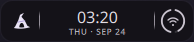
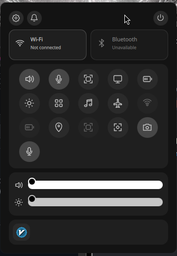
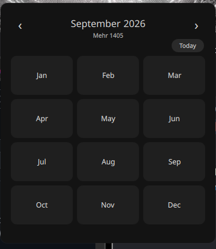
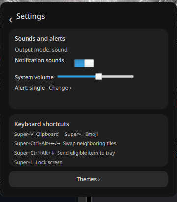

# Wizarch

A compact desktop shell for Arch Linux, Hyprland, and Quickshell. One floating pill opens an app launcher, calendar, quick settings, theme picker, and a titleless notification center. Wizarch uses flat Material-inspired surfaces and a custom wizard-hat mark.

<p align="center"></p>

## Screenshots

| Quick settings | Notifications |
| --- | --- |
|  |  |

| Calendar · week | Calendar · month |
| --- | --- |
|  |  |

<p align="center"></p>

| Launcher | Settings |
| --- | --- |
|  |  |

<p align="center"></p>

## What it does

- Opens on the focused monitor and dismisses with Escape, an outside click, or an inactivity timeout (except the launcher).
- Opens the launcher to pinned apps and custom groups, with search, All apps, and command entry. Compact groups show four preview icons; large groups show eight launchable apps and a ninth tile that opens the full group. Right click empty space to create a group, or right click an app for launch, pin, and group actions. In Edit apps, click a tile to add or remove it from the current group.
- Shows rolling week, month, and year calendars with Solar Hijri dates, and nine independent workspaces per monitor.
- Controls available Wi-Fi, Bluetooth, audio, privacy, power, and backlight devices. Unsupported controls are dimmed.
- Includes clipboard history, an emoji picker, media playback controls, tray icons, and desktop notifications.
- Applies theme colors, wallpaper, logo, and Hyprland borders together. The bundled **Wizarch** theme is ready to use.

## Requirements

This setup targets **Arch Linux with a Lua-based Hyprland configuration**. It was checked with Hyprland 0.56.2 and Quickshell 0.3.1. Install the core packages:

```sh
sudo pacman -S --needed git hyprland quickshell python util-linux kitty pipewire wireplumber upower wl-clipboard cliphist
```

The optional screenshot action uses `grim`, `slurp`, `satty`, and `wl-clipboard`:

```sh
sudo pacman -S --needed grim slurp satty wl-clipboard
```

Bluetooth needs BlueZ and an adapter. Wi-Fi browsing and hotspot need NetworkManager and `nmcli`; basic radio toggling uses `/dev/rfkill`. Battery saver needs `power-profiles-daemon`, recording needs `wf-recorder`, and laptop brightness uses a backlight device and logind. Controls without those capabilities remain unavailable. Wizarch owns the `org.freedesktop.Notifications` service, so stop any other notification daemon before starting it. See the official [Quickshell installation guide](https://quickshell.org/docs/v0.3.0/guide/install-setup/) and [Hyprland Lua configuration guide](https://wiki.hypr.land/configuring/core/) if your system uses a different setup.

## Manual installation

1. Clone the repository and back up an existing Quickshell configuration. Run these commands from a terminal inside your Hyprland session:

   ```sh
   git clone https://github.com/ManiWizard/Wizarch.git
   cd Wizarch
   mkdir -p "$HOME/.config"
   if [ -e "$HOME/.config/quickshell" ]; then
       mv "$HOME/.config/quickshell" "$HOME/.config/quickshell.backup.$(date +%s)"
   fi
   cp -a quickshell "$HOME/.config/quickshell"
   ```

2. Install the small helper scripts. The screenshot helper is useful only if its optional packages above are installed.

   ```sh
   install -Dm755 scripts/wizarch-open "$HOME/.local/bin/wizarch-open"
   install -Dm755 scripts/hypr-desktop "$HOME/.local/bin/hypr-desktop"
   install -Dm755 scripts/hypr-screenshot "$HOME/.local/bin/hypr-screenshot"
   ```

3. Initialize the bundled theme. This creates local theme state and `~/.config/hypr/wizarch-theme.lua` before Hyprland tries to load it.

   ```sh
   python3 "$HOME/.config/quickshell/services/themes.py" init wizarch
   ```

4. Add the supplied Lua bindings to your **existing** Hyprland config. Keep your monitor and other personal settings; remove or adjust bindings that conflict with those in the example.

   ```sh
   install -Dm644 examples/hyprland-wizarch.lua "$HOME/.config/hypr/wizarch-bindings.lua"
   install -Dm644 examples/wizarch-windows.lua "$HOME/.config/hypr/wizarch-windows.lua"
   ```

   Add this line near the end of `~/.config/hypr/hyprland.lua`:

   ```lua
   dofile(os.getenv("HOME") .. "/.config/hypr/wizarch-bindings.lua")
   ```

   The example loads the generated theme fragment, starts Quickshell and clipboard history at login, and adds panel and workspace shortcuts. Install the lock configuration as well:

   ```sh
   install -Dm644 examples/hyprlock.conf "$HOME/.config/hypr/hyprlock.conf"
   ```

   `Super+L` requires `hyprlock`. Do not replace your Lua config with a legacy `hyprland.conf` snippet.

5. Reload Hyprland and start Wizarch in the current session. The autostart hook applies on the next login.

   ```sh
   hyprctl reload
   qs --no-duplicate --daemonize
   ~/.local/bin/wizarch-open status
   ```

   If a panel does not open, inspect `qs log -t 40` and `hyprctl configerrors`.

## Controls

| Shortcut or click | Action |
| --- | --- |
| Left-click hat / `Super+Space` | Launcher |
| Right-click hat / `Super+Alt+T` | Themes |
| Click clock / `Super+Alt+C` | Calendar |
| Click the month or year in the calendar | Open month or year view |
| Today | Return to the rolling week |
| Click status / `Super+Alt+Q` | Quick settings |
| Bell / `Super+Alt+N` | Notifications |
| `Super+V` / `Super+.` | Clipboard history / emoji picker |
| `Super+arrows` | Focus a neighboring window |
| `Super+Shift+arrows` | Move the focused window to the monitor in that direction and follow it |
| `Super+Ctrl+Shift+arrows` | Alias for moving the focused window to the monitor in that direction |
| `Super+J` | Toggle horizontal/vertical split (dwindle) |
| `Super+Ctrl+L` | Toggle Dwindle/Scrolling on the current workspace; choice is remembered |
| `Super+T` / `Super+Shift+V` | Toggle floating/tiling |
| `Super+F` | Toggle fullscreen |
| `Super+Alt+F` | Toggle maximized within the monitor work area |
| `Super+M` | Minimize the focused window to the tray |
| `Super+Shift+M` / click a window's tray icon | Restore the last minimized / selected window here |
| `Super+O` | Float and pin a window across workspace changes; press again to restore its previous state |
| `Super+−` / `Super+=` | Shrink/grow width by 100 px; add Shift for height |
| Add `Alt` / `Ctrl` to resize | Use 25 / 300 px steps; hold to repeat |
| `Super+left/right mouse drag` | Move / resize a window |
| `Alt+Tab` / `Alt+Shift+Tab` | Focus and raise next / previous window on the current workspace |
| `Super+W` | Open the shell quick-action wheel |
| `Super+C` | Close the focused window |
| `Super+Ctrl+Alt+Left/Right/Down/Up` | Existing aliases: swap left/right, minimize, show/hide all tray windows |
| `Super+L` | Lock the current session |
| `Super+1…9` | Switch workspace 1–9 on the focused monitor |
| `Super+Shift+1…9` | Move the focused window to workspace 1–9 on its monitor |
| `Super+mouse wheel` | Cycle workspaces 1–9 on the focused monitor |
| `Super+D` | Toggle an empty desktop on the focused monitor |
| `Super+Shift+S` | Select and annotate a screenshot |

Scrolling keeps one large app centered, with small **real-window side peeks** showing its neighbors. A lone column fills the work area; two or more columns each use 96% of it, leaving about 2% per side before normal gaps and borders. At the strip's ends only the existing neighbor peeks. Native windows retain their borders, stay live, and can receive pointer input directly. There is no preview-card gutter, capture cache, or extra screen reservation. A click-through frame guard reuses the original outline on Scrolling outputs so native offscreen windows cannot cover the screen border.

`Super+Left/Right` moves through the strip and wraps at its ends; `Super+Shift+arrows` moves the focused window to the monitor in that direction; `Super+Ctrl+Alt+Left/Right` swaps columns. `Alt+Tab` also cycles windows. Fullscreen/maximize still use their existing shortcuts. Other workspaces retain their layout. Choices are stored in `~/.config/wizarch/workspace-layouts.json` and loaded through the generated `~/.config/hypr/wizarch-layouts.lua` fragment. `Super+L` continues to lock the screen. The Lua module reconciles column widths after open/close/focus and workspace events, with a 500 ms fallback for layout changes; it counts distinct native columns so vertically stacked windows do not create false peeks. Existing manual resize shortcuts remain effective until column membership/layout changes. Screen frame, pill, and the Settings window-spacing value are independent of this behavior.

Minimized applications keep running. Restore sends only the selected window to the focused monitor’s current workspace, preserving the other monitors’ workspace choices. Floating geometry is clamped to the destination monitor, and fullscreen/pin state is restored. The tray refreshes when windows move or close. Window history lives only for the current Hyprland session. Resize uses the named minus/equal keys; adjust these in `examples/wizarch-windows.lua` for other keyboard layouts. Keep `Super+Q` available for your existing terminal shortcut.

Each monitor has its own nine workspace slots, displayed as 1–9 in that monitor’s pill. `Super+1…9`, `Super+Shift+1…9`, and `Super+scroll` operate on the focused monitor; other monitors keep their current workspace. `Super+D` shows/restores the desktop only on the focused monitor. Existing workspace names and layout choices are preserved. The monitor-to-workspace mapping is saved in `~/.config/wizarch/workspace-monitors.json`; generated monitor bindings and persistent workspace rules load from `~/.config/hypr/wizarch-workspaces.lua`. Reconnecting an output reuses its own slots.

## Boot, sign-in, and lock

The repository includes a Wizarch Plymouth boot splash, a styled greetd/ReGreet sign-in screen offering the installed Hyprland sessions to all users, and a separate Hyprlock screen with a dark translucent silhouette over a blurred desktop capture. The [startup installer](scripts/install-startup-security) makes the system changes and prints the root account status before it enables the greeter. Run it from the repository root with `sudo` after reviewing its backup and boot-loader steps:

```sh
sudo bash scripts/install-startup-security
```

The installer backs up greetd, mkinitcpio, and GRUB configuration, installs the greeter and boot theme, regenerates the initramfs and GRUB configuration, then enables greetd for the next boot. Root is reserved for administration through `sudo` or a text console; no root desktop session is configured. If your machine uses another boot loader or initramfs tool, follow the [Arch Plymouth guide](https://wiki.archlinux.org/title/Plymouth) for that part instead. Hyprlock is a distinct post-login lock screen.

Settings opens as a normal tiled window with a searchable category sidebar, grouped controls, theme previews and bundled wallpaper thumbnails. Use Ctrl+F to find a category; narrow windows use an icon sidebar. Appearance selects complete Wizarch theme packs, including their wallpaper and accent palette.

The quick-action wheel stays open after `Super+W`: point and click a sector, or use direction arrows or Tab (Shift+Tab reverses) and Enter/Space. Escape, right-click, a centre/outside click or another `Super+W` cancels. Home/End select the first/last action. It offers Launcher, Calendar, Quick Settings, Notifications, Clipboard, Screenshot, Themes and Settings, and opens at the focused monitor’s center and moves the cursor to that same global logical point on opening. Closing leaves the cursor in place. The compact continuous ring uses the active Wizarch palette and shows icons with the selected action’s name, or Cancel in the center dead zone. Arrows select their cardinal direction; Tab cycles all eight actions. Its overlay reserves no desktop space.

## Themes and source layout

`quickshell/` is the shell source; `scripts/` contains the panel, desktop, and screenshot helpers; `examples/` contains the optional Hyprland integration. Theme definitions live under `quickshell/themes/<id>/`. The theme picker only lists themes whose assets are present.

The **Eclipse** theme metadata is included, but its third-party Berserk wallpaper is not. To enable Eclipse, provide your own image at `~/.config/quickshell/themes/eclipse/assets/wallpaper.jpg`, then reopen the theme picker. Generated state under `quickshell/state/`, local backups, and development outputs are excluded from the repository.

## License

Wizarch's repository source and included original assets are available under the [MIT License](LICENSE). Third-party assets are not included.

The local Material theme pipeline, authoring, recovery and deferred source contracts are documented in [the Material theme completion report](docs/material-theme/COMPLETION-REPORT.md).

Maintenance: [design-preserving upgrade and recovery](docs/design-preserving-upgrade.md) documents the bounded state readers, keyboard fixes, verification suites, and manifest-based deployment/restore workflow.
